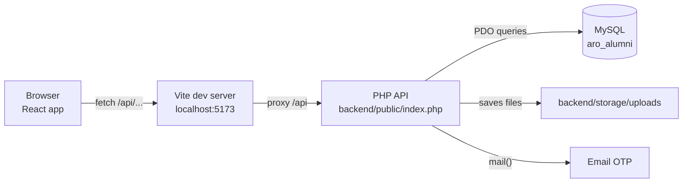
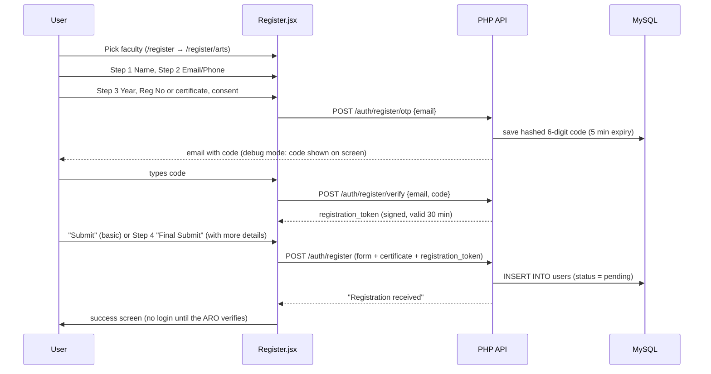
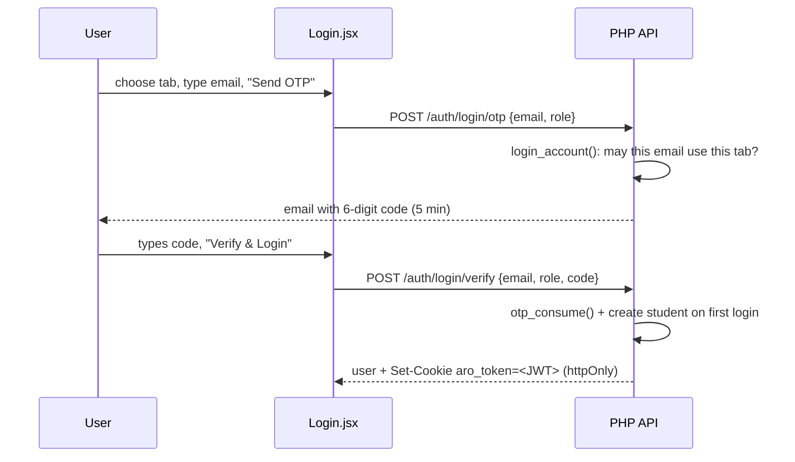
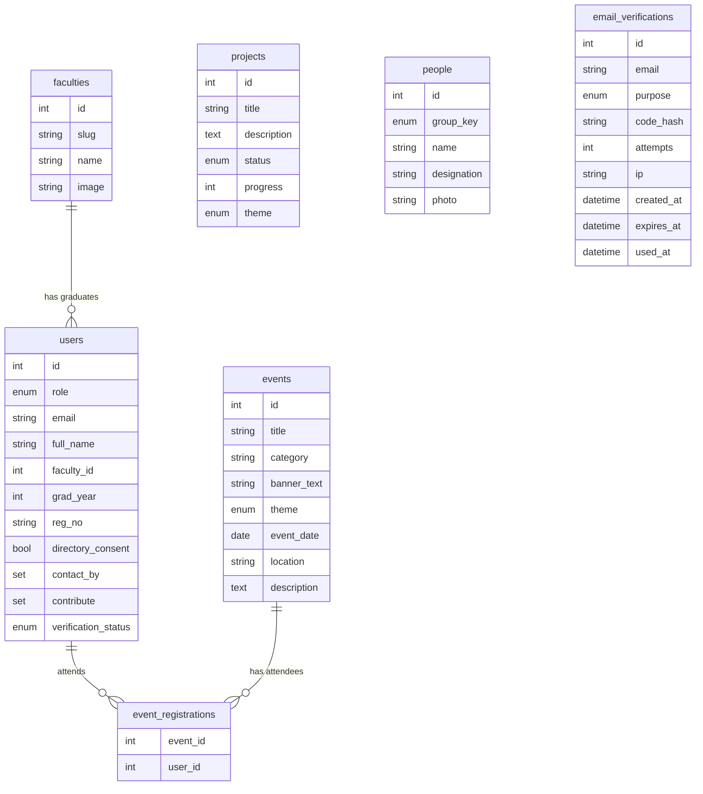

# Project Guide: University of Peradeniya Alumni Website

This guide explains **what the website does**, **how it works**, and **which file to open when you want
to change something**. For install and run commands, see the [README](../README.md).

---

## Contents

1. [What the website is](#1-what-the-website-is)
2. [Who uses it and what they can do](#2-who-uses-it-and-what-they-can-do)
3. [How the pieces fit together](#3-how-the-pieces-fit-together)
4. [How a request travels](#4-how-a-request-travels)
5. [The main flows step by step](#5-the-main-flows-step-by-step)
6. [Database](#6-database)
7. [File map: where everything lives](#7-file-map-where-everything-lives)
8. ["I want to change…": quick lookup](#8-i-want-to-change-quick-lookup)
9. [Common tasks, step by step](#9-common-tasks-step-by-step)
10. [Security rules built in](#10-security-rules-built-in)
11. [Troubleshooting](#11-troubleshooting)
12. [Not built yet](#12-not-built-yet)

---

## 1. What the website is

The portal of the **Alumni Relations Office (ARO)** at the University of Peradeniya. It lets graduates:

- **register** as alumni of their faculty (with email verification),
- **see events** and confirm attendance,
- **see university projects** they can support,
- **see the patrons / advisory committees** of the ARO,
- **find other alumni** in a directory,
- **keep their profile up to date** (job, country, how they want to contribute).

The ARO uses the collected data to verify graduates and to reach alumni for mentoring, guest
lectures, internships, scholarships and events.

**Tech stack**

| Part     | Technology                                 | Why                                                |
| -------- | ------------------------------------------ | -------------------------------------------------- |
| Frontend | React 19 + React Router + Tailwind CSS 4   | Fast single-page app; pages change without reload  |
| Build    | Vite                                       | Dev server with instant reload; production build   |
| Backend  | PHP 8 (plain PHP, PDO), no framework       | Runs on any cheap host / XAMPP, easy to read       |
| Database | MySQL / MariaDB                            | Stores users, events, projects, people, faculties  |

---

## 2. Who uses it and what they can do

| Visitor type            | Can do                                                                                       |
| ----------------------- | -------------------------------------------------------------------------------------------- |
| **Anyone (not logged in)** | Home, People, Events, Projects pages; register as alumni; log in                          |
| **Alumni (logged in)**  | Everything above + confirm/cancel event attendance, Directory, edit profile                  |
| **Student (logged in)** | Events attendance, Directory, edit name/phone                                                |
| **Admin**               | Can log in on either tab; no admin screens yet (use phpMyAdmin)                              |

**Nobody has a password.** Everyone logs in with a one-time code sent to their email:

- **Student Login**: any email on `@pdn.ac.lk` or a subdomain such as `@sci.pdn.ac.lk`. The account is
  created automatically on first login.
- **Alumni Login**: only alumni the ARO has **verified**. Newly registered alumni wait until approved.

### Pages

| URL                     | Page                         | Login needed |
| ----------------------- | ---------------------------- | :----------: |
| `/`                     | Home (videos, ARO message, faculty cards) |  |
| `/people`               | Patrons & committees         |              |
| `/events`               | Events list + attendance     | to confirm   |
| `/projects`             | Ongoing & completed projects |              |
| `/register`             | Choose your faculty          |              |
| `/register/engineering` | 4-step registration form     |              |
| `/login`                | Email + OTP login (Student / Alumni tabs) |  |
| `/directory`            | Alumni directory with search |      ✔       |
| `/profile`              | Your record + edit details   |      ✔       |
| anything else           | 404 page                     |              |

---

## 3. How the pieces fit together



- The **React app** draws every page in the browser. It never talks to MySQL directly.
- Whenever a page needs data (events, faculties…) it calls the **PHP API** at `/api/...`.
- The **PHP API** checks the request, reads or writes **MySQL**, and answers with **JSON**.
- **Login is a JWT**: after a correct email code, PHP signs a token (JSON Web Token) saying "user 5,
  alumni, valid until …" and stores it in an **httpOnly cookie** named `aro_token`. The browser sends it
  with every request; PHP checks the signature and re-reads the user from MySQL each time.
  JavaScript cannot read the cookie, so an injected script can't steal the login.

**In development** you run two servers (Vite on `5173`, PHP on `8000`). Vite forwards `/api` to PHP,
so the browser thinks it's one website, and cookies work with no CORS setup.

**In production** there's one Apache server. `frontend/dist/` (the built React app) sits in the web root
next to the `backend/` folder, and the `.htaccess` in the web root sends `/api/*` to PHP and everything
else to `index.html`.

---

## 4. How a request travels

Example: the Events page loads.

```
1. Browser opens /events
2. React Router shows        frontend/src/pages/Events.jsx
3. Events.jsx calls          useApi('/events')               → frontend/src/api/useApi.js
4. useApi calls              api.get('/events')              → frontend/src/api/client.js
5. fetch('/api/events')      → Vite proxy → PHP
6. PHP entry point           backend/public/index.php        (strips "/api" → "/events")
7. Startup                   backend/src/bootstrap.php       (config, DB connection, JWT helpers)
8. Route lookup              backend/src/routes.php          ('/events' → handle_events)
9. Handler runs              backend/src/handlers/content.php → handle_events()
10. SQL on MySQL, result returned as JSON:  {"events":[...]}
11. Events.jsx receives the data and draws the event cards
```

**Errors** follow the same path back. A handler throws `HttpError(status, message, fields)`, the router
turns it into `{"error": "...", "fields": {...}}`, and `client.js` turns that into an `ApiError`
the page can show (e.g. a red message under the right input box).

---

## 5. The main flows step by step

### 5.1 Registration



Key points:

- **Two submit options:** "Submit" on step 3 saves the basic details only. "More Details →" goes to step 4,
  where country, profession, contact preferences and contribution options become required.
- The email must be **OTP-verified**: the form sends the `registration_token` from the verify step,
  and the API refuses the registration if the token is missing, expired or for a different email.
- Registering does **not** log you in. The alumnus can log in once the ARO marks them `verified`.
- **Reg No vs certificate:** if the user remembers their registration number they type it.
  Otherwise they must upload their degree certificate (PDF/JPG/PNG, max 5 MB).
- New users start as **`pending`**. The ARO changes them to **`verified`** after checking.
- If the server rejects a field, the form **jumps back to the step** containing that field
  (the `FIELD_STEP` map in `Register.jsx`).

### 5.2 Login / logout (passwordless)



1. **Who may use which tab** is decided by `login_account()` in `auth.php`:
   - *Alumni tab*: the email must belong to an alumni account with status `verified`. Unknown emails get
     "Please register first", and pending ones get "still being verified".
   - *Student tab*: the email must end in a domain from `student_email_domains` in `config.php`
     (`pdn.ac.lk` allows every faculty subdomain). Alumni emails are sent to the Alumni tab.
   - An `admin` account is allowed on both tabs.
2. **Limits** (`otp.php`, numbers in `config.php`): code valid 5 min; 3 codes per email per 15 min;
   10 per IP per 15 min; 5 wrong guesses per code; requesting a new code cancels the old one.
3. **On success** `issue_auth_token()` (`jwt.php`) puts the JWT in the `aro_token` cookie.
   `AuthContext.jsx` stores the returned user, so the header shows their name and Logout.
4. **Every request**: `current_user()` (`http.php`) checks the JWT signature and expiry, then reloads
   the user. If the ARO un-verifies an alumnus, their next request is treated as logged out.
5. When the site loads, `AuthContext.jsx` calls `GET /auth/me` to find out if you're still logged in.
6. Logout calls `POST /auth/logout`, which deletes the cookie.

### 5.3 Protected pages

`ProtectedRoute.jsx` wraps `/directory` and `/profile`. If nobody is logged in it redirects to
`/login` and remembers where you were going, so after logging in you land back there.
The PHP side checks again with `require_login()`, so the API can't be used without logging in.

### 5.4 Events attendance

- `GET /events` returns every event with `attendees` (count), `registered` (did *you* sign up) and
  `is_past`. Upcoming events come first.
- "Confirm attendance" → `POST /events/{id}/register`. "Cancel" → `DELETE /events/{id}/register`.
- Past events show "This event has ended". Not-logged-in visitors see "Log in to confirm attendance".

### 5.5 Directory

- Lists users where **role = alumni AND directory_consent = 1 AND verification_status = verified**.
- Shows **only name, faculty and batch year**, which is what the registration checkbox promises.
- Filters: name search (waits until you stop typing), faculty, year; 24 per page.
  The filters are kept in the URL (`/directory?faculty=arts&year=2010`), so the link can be shared.

### 5.6 Profile

- Left side: the fixed record (full name, faculty, year, reg no). Changing these needs the ARO.
- Right side: editable details → `PUT /profile`.
- Students can also correct their full name (it starts as a guess from their email address).
- A coloured banner shows the verification status.

---

## 6. Database

Database name: **`aro_alumni`**. Created by `backend/database/schema.sql`, filled by `seed.sql`.



| Table                  | Holds                                                   | Notes                                                    |
| ---------------------- | ------------------------------------------------------- | -------------------------------------------------------- |
| `faculties`            | The 9 faculties                                         | `slug` is used in URLs (`/register/allied-health`)       |
| `users`                | Alumni, students, admins                                | No passwords; `contact_by`/`contribute` are SET columns  |
| `email_verifications`  | OTP codes for `login` and `register`                    | Hashed; 5 min expiry; kept 24 h for rate limiting        |
| `events`               | Events                                                  | `theme` = banner colour: maroon / blue / green / orange  |
| `event_registrations`  | Who is attending what                                   | One row per user per event (unique)                      |
| `projects`             | Ongoing & completed projects                            | `progress` 0–100 or NULL (no bar); `theme` = colour      |
| `people`               | Patrons / committee members                             | `group_key` decides which section of the People page     |

**Allowed option values** (must match in 3 places: `schema.sql`, `handlers/users.php`, `data/options.js`):

- `contact_by`: `students_mentoring`, `university_events`, `other_alumni`
- `contribute`: `mentoring`, `guest_lecture`, `internship`, `donation`, `scholarships`, `networking`, `not_now`
- `verification_status`: `pending`, `verified`, `rejected`
- `people.group_key`: `leadership`, `overseas_advisory`, `university_advisory`, `aro`

---

## 7. File map: where everything lives

```
Alumni_website/
├── README.md                      Install / run / deploy instructions
├── doc/
│   └── PROJECT_GUIDE.md           ← this file
│
├── frontend/                      ===== REACT APP =====
│   ├── index.html                 HTML shell: page title, Google font, favicon
│   ├── package.json               npm packages and scripts (dev / build / preview)
│   ├── vite.config.js             Vite + the /api proxy to PHP
│   ├── .env.example               VITE_API_PROXY / VITE_API_BASE settings
│   ├── public/                    Copied as-is to the website
│   │   ├── .htaccess              Apache rules for the deployed site
│   │   ├── images/                Logo, campus photos
│   │   │   └── faculties/         One photo per faculty card
│   │   └── video/                 Home page campus video
│   └── src/
│       ├── main.jsx               Starts React; wraps app in Router + AuthProvider
│       ├── App.jsx                ★ All page URLs (routes) are defined here
│       ├── index.css              ★ Tailwind + colours (maroon, gold…) + button/input styles
│       ├── api/
│       │   ├── client.js          fetch wrapper: api.get/post/put/delete, ApiError
│       │   └── useApi.js          Hook: load data from an endpoint (+ loading/error)
│       ├── context/
│       │   └── AuthContext.jsx    Who is logged in; requestLoginCode() / verifyLogin() / logout()
│       ├── data/
│       │   └── options.js         Countries, contact/contribute checkbox lists, year range
│       ├── components/            Pieces reused by several pages
│       │   ├── Layout.jsx         Header + page + Footer wrapper; scrolls to top on page change
│       │   ├── Header.jsx         ★ Top maroon bar, logo, navigation menu, mobile menu
│       │   ├── Footer.jsx         Footer text
│       │   ├── ProtectedRoute.jsx Sends logged-out users to /login
│       │   ├── FacultyGrid.jsx    Faculty photo cards (Home + Register pages)
│       │   ├── YearPicker.jsx     Decade tabs + year grid for graduation year
│       │   ├── Field.jsx          Label + input + error message; CheckboxGroup
│       │   ├── OtpInput.jsx       6-digit code box + resend countdown (Login + Register)
│       │   └── Status.jsx         Loading spinner, error box, Alert messages
│       └── pages/                 One file per page
│           ├── Home.jsx           Videos, ARO message, faculty cards
│           ├── People.jsx         Patrons and committees
│           ├── Events.jsx         Event cards + attendance buttons
│           ├── Projects.jsx       Ongoing (with progress bar) + completed projects
│           ├── Directory.jsx      Alumni search
│           ├── Login.jsx          ★ Email → OTP → login, Student/Alumni tabs
│           ├── RegisterFaculty.jsx "Select your faculty" page
│           ├── Register.jsx       ★ 4-step registration form + OTP box
│           ├── Profile.jsx        My record, edit details
│           └── NotFound.jsx       404 page
│
└── backend/                       ===== PHP API =====
    ├── .gitignore                 Keeps config.php and uploads out of git
    ├── public/                    The ONLY folder the web server should expose
    │   ├── index.php              Entry point: every /api request starts here
    │   └── .htaccess              Sends all requests to index.php
    ├── config/
    │   ├── config.example.php     Template: DB, debug, JWT secret, student domains, OTP limits, uploads
    │   └── config.php             Your real settings (not in git, create from example)
    ├── src/
    │   ├── bootstrap.php          Loads config, connects to MySQL (db()), checks the JWT secret
    │   ├── jwt.php                Create/check JWTs, set/clear the aro_token cookie
    │   ├── http.php               Helpers: json_response, input readers, current_user, require_login, HttpError, CORS
    │   ├── Router.php             Matches method + path to a handler function
    │   ├── routes.php             ★ List of every API endpoint → handler function
    │   └── handlers/              The actual logic
    │       ├── auth.php           ★ who may log in (login_account), login, logout, register, uploads
    │       ├── otp.php            Create, email, rate-limit and check one-time codes
    │       ├── users.php          User lookup, what user data is returned, shared validation
    │       ├── content.php        faculties, people, projects, events, event attendance
    │       ├── directory.php      Directory search
    │       └── profile.php        Edit profile
    ├── database/
    │   ├── schema.sql             ★ Creates the database and all tables
    │   ├── seed.sql               Starting data + 2 demo alumni
    │   └── migrations/            Upgrade scripts for databases created with an older schema
    └── storage/
        └── uploads/               Uploaded degree certificates (blocked from the web)
```

★ = the files you'll open most often.

The `.htaccess` files inside `backend/config`, `src`, `database` and `storage` block web access to
those folders. Don't delete them.

---

## 8. "I want to change…": quick lookup

| I want to change…                                   | Open this file                                                    |
| --------------------------------------------------- | ----------------------------------------------------------------- |
| Navigation menu items / top bar text                | `frontend/src/components/Header.jsx` (`NAV` list at the top)      |
| Footer text                                         | `frontend/src/components/Footer.jsx`                              |
| Site colours (maroon, gold…) or font                | `frontend/src/index.css` (`@theme` block)                         |
| Button / input box style everywhere                 | `frontend/src/index.css` (`.btn-primary`, `.input`…)              |
| Browser tab title, favicon                          | `frontend/index.html`                                             |
| Home page videos or the ARO welcome message         | `frontend/src/pages/Home.jsx`                                     |
| Logo or campus photos                               | `frontend/public/images/`                                         |
| Faculty card photo                                  | `frontend/public/images/faculties/` (+ `image` column in `faculties`) |
| Faculty names / order                               | `faculties` table (`seed.sql` for fresh installs)                 |
| Events, projects, patrons (the content)             | `events` / `projects` / `people` tables (phpMyAdmin)              |
| How an event card looks                             | `frontend/src/pages/Events.jsx`                                   |
| Event banner colours                                | `BANNERS` / `BADGES` in `Events.jsx` + `theme` ENUM in `schema.sql` |
| How a project card looks                            | `frontend/src/pages/Projects.jsx`                                 |
| People page sections / cards                        | `frontend/src/pages/People.jsx`                                   |
| Registration form fields or steps                   | `frontend/src/pages/Register.jsx` **and** `handle_register()` in `backend/src/handlers/auth.php` |
| Country list / checkbox options                     | `frontend/src/data/options.js` (+ `schema.sql` and `users.php` for checkbox values) |
| Graduation year range (starts 1950)                 | `FIRST_GRAD_YEAR` in `options.js` + `MIN_GRAD_YEAR` in `users.php` |
| Allowed student email domains                       | `config.php` → `student_email_domains` (+ `isUniversityEmail` in `Login.jsx`) |
| Who may log in on the Alumni / Student tab          | `login_account()` in `backend/src/handlers/auth.php`              |
| Login messages, tabs, hints                         | `frontend/src/pages/Login.jsx` (`TABS`)                           |
| How long a login lasts (7 days)                     | `config.php` → `jwt.ttl_hours`                                    |
| JWT cookie name / settings                          | `backend/src/jwt.php`                                             |
| Name given to a new student account                 | `create_student()` in `auth.php`                                  |
| Registration number format check                    | `handle_register()` in `auth.php`                                 |
| OTP email text                                      | `otp_issue()` in `backend/src/handlers/otp.php`                   |
| OTP expiry, rate limits, wrong-guess limit          | `config.php` → `otp`                                              |
| Resend countdown (60 s)                             | `RESEND_SECONDS` in `frontend/src/components/OtpInput.jsx`        |
| Certificate size / allowed types                    | `store_degree_certificate()` in `auth.php`; size in `config.php`  |
| Who appears in the Directory and which fields show  | `handle_directory()` in `backend/src/handlers/directory.php`      |
| Directory page size (24)                            | `DIRECTORY_PAGE_SIZE` in `directory.php`                          |
| What a user can edit on Profile                     | `Profile.jsx` + `handle_update_profile()` in `profile.php`        |
| Which user data the API sends to the browser        | `user_payload()` in `backend/src/handlers/users.php`              |
| Add / rename a page URL                             | `frontend/src/App.jsx`                                            |
| Add / rename an API endpoint                        | `backend/src/routes.php`                                          |
| Database name, user, password                       | `backend/config/config.php`                                       |
| Turn debug mode on/off (shows OTP code on screen)   | `backend/config/config.php` → `'debug'`                           |
| Where the React app sends API calls                 | `frontend/.env.local` (`VITE_API_PROXY`, `VITE_API_BASE`)         |
| Error messages shown on the loading / error boxes   | `frontend/src/components/Status.jsx`                              |

---

## 9. Common tasks, step by step

### Add a new event / project / patron
No code needed. In **phpMyAdmin** open the `aro_alumni` database → `events` (or `projects`, `people`)
→ **Insert**. Refresh the website.

Example SQL:
```sql
INSERT INTO events (title, category, banner_text, theme, event_date, location, description)
VALUES ('Medical Faculty Reunion', 'Reunion', 'REUNION 2027', 'green', '2027-03-15',
        'Faculty of Medicine', 'Meet your batchmates again.');
```

For a patron photo: put the image in `frontend/public/images/people/vc.jpg` and set
`photo = 'images/people/vc.jpg'` on that row.

### Verify a newly registered alumnus
```sql
UPDATE users SET verification_status = 'verified' WHERE email = 'someone@example.com';
```
Uploaded certificates are in `backend/storage/uploads/`. The file name is in `users.degree_cert_path`.

### Add a new page (example: Blog)
1. Create `frontend/src/pages/Blog.jsx`:
   ```jsx
   export default function Blog() {
     return <section className="mx-auto max-w-7xl px-4 py-12"><h1 className="text-3xl font-bold text-maroon">Blog</h1></section>
   }
   ```
2. In `frontend/src/App.jsx`: `import Blog from './pages/Blog.jsx'` and add
   `<Route path="blog" element={<Blog />} />`. Put it inside the `ProtectedRoute` group if it needs a login.
3. In `frontend/src/components/Header.jsx` add `{ to: '/blog', label: 'Blog' }` to `NAV`.

### Add a new API endpoint (example: `GET /api/blog`)
1. Create the table in `backend/database/schema.sql` (and run the `CREATE TABLE` in phpMyAdmin).
2. Write the handler, e.g. in a new `backend/src/handlers/blog.php`:
   ```php
   <?php
   declare(strict_types=1);

   function handle_blog_posts(): array
   {
       $rows = db()->query('SELECT id, title, body, created_at FROM blog_posts ORDER BY created_at DESC')->fetchAll();
       return ['posts' => $rows];
   }
   ```
   Need a login? Start the function with `$userId = require_login();`.
   Reading user input? Use `str_input('title', 200)`, `bool_input(...)`, `set_input(...)`.
   Bad input? `throw new HttpError(422, 'Message', ['field' => 'what is wrong']);`
   **Always use prepared statements** (`db()->prepare('... WHERE id = ?')->execute([$id])`). Never put
   user input straight into SQL.
3. In `backend/src/routes.php`: `require __DIR__ . '/handlers/blog.php';` and
   `$router->get('/blog', 'handle_blog_posts');`
4. Use it in React: `const { data, loading, error } = useApi('/blog')`.

### Add a field to the registration form (example: "NIC number")
1. **Database**: `ALTER TABLE users ADD nic VARCHAR(20) NULL;` (also add it to `schema.sql`).
2. **Form**: in `Register.jsx` add `nic: ''` to `EMPTY_FORM`, an input in the right step, a check in
   `validateStep()`, `body.append('nic', ...)` in `submit()`, and `nic: <step>` in `FIELD_STEP`.
3. **API**: in `handle_register()` (`auth.php`) read `str_input('nic', 20)`, validate it, and add it to
   the `INSERT` column list and values.
4. **Show it back**: add `'nic' => $u['nic']` to `user_payload()` in `users.php`, and show it in `Profile.jsx`.

### Add a new faculty
```sql
INSERT INTO faculties (slug, name, image, sort_order)
VALUES ('computing', 'Faculty of Computing', 'images/faculties/computing.jpg', 10);
```
Then add the photo at `frontend/public/images/faculties/computing.jpg`.

### Change a checkbox option (contact_by / contribute)
Change it in **all three** places, or saving will fail:
`frontend/src/data/options.js`, `CONTACT_BY_OPTIONS`/`CONTRIBUTE_OPTIONS` in `backend/src/handlers/users.php`,
and the `SET(...)` column in `schema.sql` (on an existing DB: `ALTER TABLE users MODIFY contribute SET(...)`).

---

## 10. Security rules built in

| Protection                               | Where                                              |
| ---------------------------------------- | -------------------------------------------------- |
| No passwords to leak: login by one-time email code only  | `auth.php`, `otp.php`                  |
| JWT signed with HS256 + server secret; signature, expiry and purpose checked | `jwt.php`          |
| JWT kept in an `HttpOnly`, `SameSite=Lax` cookie (not readable by scripts, not sent cross-site) | `jwt.php` |
| User reloaded on every request, so un-verified alumni are logged out at once | `current_user()` in `http.php` |
| SQL injection blocked: prepared statements everywhere   | all handlers                           |
| OTP codes hashed, expire in 5 min, 3 per email / 10 per IP per 15 min, 5 tries | `otp.php` |
| Registration only with a valid `registration_token` for that exact email | `handle_register()` |
| Uploads checked by real file content, random file names, stored outside `public/` | `store_degree_certificate()` |
| Config, source, SQL and uploads blocked from the web     | `.htaccess` files in `backend/*`       |
| Directory shows only consented + verified alumni, only name/faculty/batch | `directory.php`      |
| Error details hidden unless `debug` is on                | `bootstrap.php`                        |

**Before going live:** set `'debug' => false`, set a new random `jwt.secret`, delete the demo
accounts, use a strong DB password, and serve the site over HTTPS.

**Known limit of JWTs:** logging out deletes the cookie, but a copied token would stay valid until it
expires (7 days). Lower `jwt.ttl_hours` for shorter sessions, or change `jwt.secret` to log everyone out.

---

## 11. Troubleshooting

| Problem                                                    | Likely cause / fix                                                     |
| ---------------------------------------------------------- | ---------------------------------------------------------------------- |
| Pages load but show "Cannot reach the server"              | PHP server not running. Start `php -S localhost:8000 -t backend/public backend/public/index.php` |
| `Missing backend/config/config.php`                        | Copy `config.example.php` to `config.php`                              |
| "Something went wrong on the server" + `SQLSTATE[HY000] [1045]` | Wrong DB user/password in `config.php`                            |
| `SQLSTATE[HY000] [2002]`                                   | MySQL not started (XAMPP Control Panel → Start MySQL), or wrong port   |
| `Unknown database 'aro_alumni'`                            | Import `backend/database/schema.sql` first                             |
| `could not find driver`                                    | Enable `extension=pdo_mysql` in `php.ini`                              |
| `Set 'jwt.secret' in backend/config/config.php…`           | Put a random string of 32+ characters in `jwt.secret`                  |
| Login works but you're logged out on every page            | Open the site through Vite (`localhost:5173`), not the PHP port directly |
| OTP email never arrives                                    | Normal locally; keep `debug` on (code shows on screen) or set up mail  |
| "Too many codes requested…"                                | 3 codes per email per 15 min. Wait, or clear `email_verifications` while testing |
| Alumni Login says "still being verified"                   | Set `verification_status = 'verified'` for that user                   |
| Student Login says "needs your university email"           | Email must end in `pdn.ac.lk`; add other domains in `student_email_domains` |
| `Field 'password_hash' doesn't have a default value` | Old database: run `backend/database/migrations/001_passwordless_login.sql`        |
| Certificate upload fails                                   | `backend/storage/uploads/` must be writable; check PHP `upload_max_filesize` |
| New alumnus not in the Directory                           | They need `verification_status = 'verified'` **and** directory consent |
| Page refresh gives 404 on the live server                  | The `.htaccess` from `frontend/dist/` is missing or `mod_rewrite` is off |
| Changes to `.env.local` not applied                        | Restart `npm run dev`                                                  |

---

## 12. Not built yet

- **Admin panel**: verify alumni, add events/projects/people from the website (today: phpMyAdmin).
- **Blog**: was in the old menu, never built (see "Add a new page" above).
- **Donations / payments**: the site only links to the ARO by email ("Support this project").
