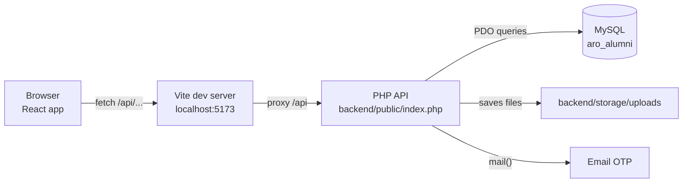
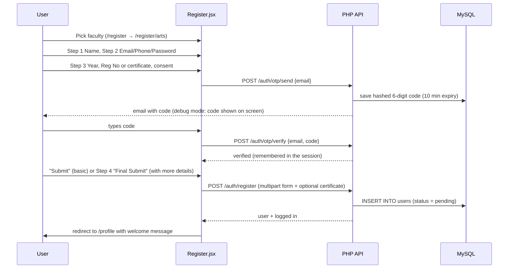
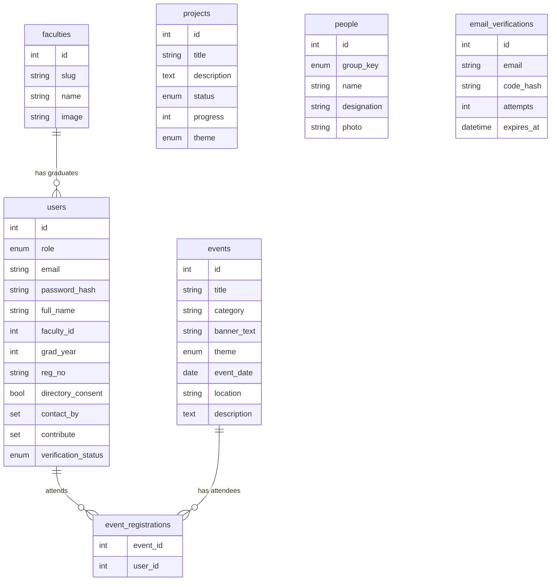

# Project Guide: University of Peradeniya Alumni Website

This guide explains **what the website does**, **how it works**, and **which file to open when you want
to change something**. For install and run commands, see the [README](../README.md).

---

## Contents

1. [What the website is](#1-what-the-website-is)
2. [Who uses it and what they can do](#2-who-uses-it-and-what-they-can-do)
3. [How the pieces fit together](#3-how-the-pieces-fit-together)
4. [How a request travels](#4-how-a-request-travels)
5. [The main flows step by step](#5-the-main-flows-step-by-step)
6. [Database](#6-database)
7. [File map: where everything lives](#7-file-map-where-everything-lives)
8. ["I want to change…": quick lookup](#8-i-want-to-change-quick-lookup)
9. [Common tasks, step by step](#9-common-tasks-step-by-step)
10. [Security rules built in](#10-security-rules-built-in)
11. [Troubleshooting](#11-troubleshooting)
12. [Not built yet](#12-not-built-yet)

---

## 1. What the website is

The portal of the **Alumni Relations Office (ARO)** at the University of Peradeniya. It lets graduates:

- **register** as alumni of their faculty (with email verification),
- **see events** and confirm attendance,
- **see university projects** they can support,
- **see the patrons / advisory committees** of the ARO,
- **find other alumni** in a directory,
- **keep their profile up to date** (job, country, how they want to contribute).

The ARO uses the collected data to verify graduates and to reach alumni for mentoring, guest
lectures, internships, scholarships and events.

**Tech stack**

| Part     | Technology                                 | Why                                                |
| -------- | ------------------------------------------ | -------------------------------------------------- |
| Frontend | React 19 + React Router + Tailwind CSS 4   | Fast single-page app; pages change without reload  |
| Build    | Vite                                       | Dev server with instant reload; production build   |
| Backend  | PHP 8 (plain PHP, PDO), no framework       | Runs on any cheap host / XAMPP, easy to read       |
| Database | MySQL / MariaDB                            | Stores users, events, projects, people, faculties  |

---

## 2. Who uses it and what they can do

| Visitor type            | Can do                                                                                       |
| ----------------------- | -------------------------------------------------------------------------------------------- |
| **Anyone (not logged in)** | Home, People, Events, Projects pages; register as alumni; log in                          |
| **Alumni (logged in)**  | Everything above + confirm/cancel event attendance, Directory, edit profile, change password |
| **Student (logged in)** | Events attendance, Directory, edit name/phone, change password                               |
| **Admin**               | Role exists in the database; no admin screens yet (use phpMyAdmin)                           |

### Pages

| URL                     | Page                         | Login needed |
| ----------------------- | ---------------------------- | :----------: |
| `/`                     | Home (videos, ARO message, faculty cards) |  |
| `/people`               | Patrons & committees         |              |
| `/events`               | Events list + attendance     | to confirm   |
| `/projects`             | Ongoing & completed projects |              |
| `/register`             | Choose your faculty          |              |
| `/register/engineering` | 4-step registration form     |              |
| `/login`                | Login (Alumni / Student tabs)|              |
| `/directory`            | Alumni directory with search |      ✔       |
| `/profile`              | Your record + edit details   |      ✔       |
| anything else           | 404 page                     |              |

---

## 3. How the pieces fit together



- The **React app** draws every page in the browser. It never talks to MySQL directly.
- Whenever a page needs data (events, faculties…) it calls the **PHP API** at `/api/...`.
- The **PHP API** checks the request, reads or writes **MySQL**, and answers with **JSON**.
- **Login is a PHP session**: after logging in, the browser holds a cookie named `aro_session`;
  PHP uses it to know who you are on every later request.

**In development** you run two servers (Vite on `5173`, PHP on `8000`). Vite forwards `/api` to PHP,
so the browser thinks it's one website, and cookies work with no CORS setup.

**In production** there's one Apache server. `frontend/dist/` (the built React app) sits in the web root
next to the `backend/` folder, and the `.htaccess` in the web root sends `/api/*` to PHP and everything
else to `index.html`.

---

## 4. How a request travels

Example: the Events page loads.

```
1. Browser opens /events
2. React Router shows        frontend/src/pages/Events.jsx
3. Events.jsx calls          useApi('/events')               → frontend/src/api/useApi.js
4. useApi calls              api.get('/events')              → frontend/src/api/client.js
5. fetch('/api/events')      → Vite proxy → PHP
6. PHP entry point           backend/public/index.php        (strips "/api" → "/events")
7. Startup                   backend/src/bootstrap.php       (config, DB connection, session)
8. Route lookup              backend/src/routes.php          ('/events' → handle_events)
9. Handler runs              backend/src/handlers/content.php → handle_events()
10. SQL on MySQL, result returned as JSON:  {"events":[...]}
11. Events.jsx receives the data and draws the event cards
```

**Errors** follow the same path back. A handler throws `HttpError(status, message, fields)`, the router
turns it into `{"error": "...", "fields": {...}}`, and `client.js` turns that into an `ApiError`
the page can show (e.g. a red message under the right input box).

---

## 5. The main flows step by step

### 5.1 Registration



Key points:

- **Two submit options:** "Submit" on step 3 saves the basic details only. "More Details →" goes to step 4,
  where country, profession, contact preferences and contribution options become required.
- The email must be **OTP-verified in the same browser session**, or registration is refused.
- **Reg No vs certificate:** if the user remembers their registration number they type it.
  Otherwise they must upload their degree certificate (PDF/JPG/PNG, max 5 MB).
- New users start as **`pending`**. The ARO changes them to **`verified`** after checking.
- If the server rejects a field, the form **jumps back to the step** containing that field
  (the `FIELD_STEP` map in `Register.jsx`).

### 5.2 Login / logout

1. `Login.jsx` sends `POST /auth/login {email, password, role}` (role = selected tab).
2. PHP checks the password hash. If an alumni account uses the Student tab (or the other way
   round), it answers "Please use Alumni Login".
3. On success PHP stores `user_id` in the session. `AuthContext.jsx` saves the user, so the header
   shows their name and a Logout button.
4. When the site loads, `AuthContext.jsx` calls `GET /auth/me` to find out if you're still logged in.
5. Logout calls `POST /auth/logout`, which clears the session.

### 5.3 Protected pages

`ProtectedRoute.jsx` wraps `/directory` and `/profile`. If nobody is logged in it redirects to
`/login` and remembers where you were going, so after logging in you land back there.
The PHP side checks again with `require_login()`, so the API can't be used without logging in.

### 5.4 Events attendance

- `GET /events` returns every event with `attendees` (count), `registered` (did *you* sign up) and
  `is_past`. Upcoming events come first.
- "Confirm attendance" → `POST /events/{id}/register`. "Cancel" → `DELETE /events/{id}/register`.
- Past events show "This event has ended". Not-logged-in visitors see "Log in to confirm attendance".

### 5.5 Directory

- Lists users where **role = alumni AND directory_consent = 1 AND verification_status = verified**.
- Shows **only name, faculty and batch year**, which is what the registration checkbox promises.
- Filters: name search (waits until you stop typing), faculty, year; 24 per page.
  The filters are kept in the URL (`/directory?faculty=arts&year=2010`), so the link can be shared.

### 5.6 Profile

- Left side: the fixed record (full name, faculty, year, reg no). Changing these needs the ARO.
- Right side: editable details → `PUT /profile`.
- Change password → `POST /profile/password`.
- A coloured banner shows the verification status (pending / verified / rejected).

---

## 6. Database

Database name: **`aro_alumni`**. Created by `backend/database/schema.sql`, filled by `seed.sql`.



| Table                  | Holds                                                   | Notes                                                    |
| ---------------------- | ------------------------------------------------------- | -------------------------------------------------------- |
| `faculties`            | The 9 faculties                                         | `slug` is used in URLs (`/register/allied-health`)       |
| `users`                | Alumni, students, admins                                | Passwords are hashed; `contact_by`/`contribute` are SET columns |
| `email_verifications`  | Temporary OTP codes                                     | Code is hashed, expires in 10 min, max 5 wrong tries     |
| `events`               | Events                                                  | `theme` = banner colour: maroon / blue / green / orange  |
| `event_registrations`  | Who is attending what                                   | One row per user per event (unique)                      |
| `projects`             | Ongoing & completed projects                            | `progress` 0–100 or NULL (no bar); `theme` = colour      |
| `people`               | Patrons / committee members                             | `group_key` decides which section of the People page     |

**Allowed option values** (must match in 3 places: `schema.sql`, `handlers/users.php`, `data/options.js`):

- `contact_by`: `students_mentoring`, `university_events`, `other_alumni`
- `contribute`: `mentoring`, `guest_lecture`, `internship`, `donation`, `scholarships`, `networking`, `not_now`
- `verification_status`: `pending`, `verified`, `rejected`
- `people.group_key`: `leadership`, `overseas_advisory`, `university_advisory`, `aro`

---

## 7. File map: where everything lives

```
Alumni_website/
├── README.md                      Install / run / deploy instructions
├── doc/
│   └── PROJECT_GUIDE.md           ← this file
│
├── frontend/                      ===== REACT APP =====
│   ├── index.html                 HTML shell: page title, Google font, favicon
│   ├── package.json               npm packages and scripts (dev / build / preview)
│   ├── vite.config.js             Vite + the /api proxy to PHP
│   ├── .env.example               VITE_API_PROXY / VITE_API_BASE settings
│   ├── public/                    Copied as-is to the website
│   │   ├── .htaccess              Apache rules for the deployed site
│   │   ├── images/                Logo, campus photos
│   │   │   └── faculties/         One photo per faculty card
│   │   └── video/                 Home page campus video
│   └── src/
│       ├── main.jsx               Starts React; wraps app in Router + AuthProvider
│       ├── App.jsx                ★ All page URLs (routes) are defined here
│       ├── index.css              ★ Tailwind + colours (maroon, gold…) + button/input styles
│       ├── api/
│       │   ├── client.js          fetch wrapper: api.get/post/put/delete, ApiError
│       │   └── useApi.js          Hook: load data from an endpoint (+ loading/error)
│       ├── context/
│       │   └── AuthContext.jsx    Who is logged in; login() / logout() for every page
│       ├── data/
│       │   └── options.js         Countries, contact/contribute checkbox lists, year range
│       ├── components/            Pieces reused by several pages
│       │   ├── Layout.jsx         Header + page + Footer wrapper; scrolls to top on page change
│       │   ├── Header.jsx         ★ Top maroon bar, logo, navigation menu, mobile menu
│       │   ├── Footer.jsx         Footer text
│       │   ├── ProtectedRoute.jsx Sends logged-out users to /login
│       │   ├── FacultyGrid.jsx    Faculty photo cards (Home + Register pages)
│       │   ├── YearPicker.jsx     Decade tabs + year grid for graduation year
│       │   ├── Field.jsx          Label + input + error message; CheckboxGroup
│       │   └── Status.jsx         Loading spinner, error box, Alert messages
│       └── pages/                 One file per page
│           ├── Home.jsx           Videos, ARO message, faculty cards
│           ├── People.jsx         Patrons and committees
│           ├── Events.jsx         Event cards + attendance buttons
│           ├── Projects.jsx       Ongoing (with progress bar) + completed projects
│           ├── Directory.jsx      Alumni search
│           ├── Login.jsx          Login form with Alumni/Student tabs
│           ├── RegisterFaculty.jsx "Select your faculty" page
│           ├── Register.jsx       ★ 4-step registration form + OTP box
│           ├── Profile.jsx        My record, edit details, change password
│           └── NotFound.jsx       404 page
│
└── backend/                       ===== PHP API =====
    ├── .gitignore                 Keeps config.php and uploads out of git
    ├── public/                    The ONLY folder the web server should expose
    │   ├── index.php              Entry point: every /api request starts here
    │   └── .htaccess              Sends all requests to index.php
    ├── config/
    │   ├── config.example.php     Template: DB login, debug, OTP and upload settings
    │   └── config.php             Your real settings (not in git, create from example)
    ├── src/
    │   ├── bootstrap.php          Loads config, connects to MySQL (db()), starts session
    │   ├── http.php               Helpers: json_response, input readers, require_login, HttpError, CORS
    │   ├── Router.php             Matches method + path to a handler function
    │   ├── routes.php             ★ List of every API endpoint → handler function
    │   └── handlers/              The actual logic
    │       ├── auth.php           me, login, logout, OTP send/verify, register, certificate upload
    │       ├── users.php          User lookup, what user data is returned, shared validation
    │       ├── content.php        faculties, people, projects, events, event attendance
    │       ├── directory.php      Directory search
    │       └── profile.php        Edit profile, change password
    ├── database/
    │   ├── schema.sql             ★ Creates the database and all tables
    │   └── seed.sql               Starting data + 2 demo accounts
    └── storage/
        └── uploads/               Uploaded degree certificates (blocked from the web)
```

★ = the files you'll open most often.

The `.htaccess` files inside `backend/config`, `src`, `database` and `storage` block web access to
those folders. Don't delete them.

---

## 8. "I want to change…": quick lookup

| I want to change…                                   | Open this file                                                    |
| --------------------------------------------------- | ----------------------------------------------------------------- |
| Navigation menu items / top bar text                | `frontend/src/components/Header.jsx` (`NAV` list at the top)      |
| Footer text                                         | `frontend/src/components/Footer.jsx`                              |
| Site colours (maroon, gold…) or font                | `frontend/src/index.css` (`@theme` block)                         |
| Button / input box style everywhere                 | `frontend/src/index.css` (`.btn-primary`, `.input`…)              |
| Browser tab title, favicon                          | `frontend/index.html`                                             |
| Home page videos or the ARO welcome message         | `frontend/src/pages/Home.jsx`                                     |
| Logo or campus photos                               | `frontend/public/images/`                                         |
| Faculty card photo                                  | `frontend/public/images/faculties/` (+ `image` column in `faculties`) |
| Faculty names / order                               | `faculties` table (`seed.sql` for fresh installs)                 |
| Events, projects, patrons (the content)             | `events` / `projects` / `people` tables (phpMyAdmin)              |
| How an event card looks                             | `frontend/src/pages/Events.jsx`                                   |
| Event banner colours                                | `BANNERS` / `BADGES` in `Events.jsx` + `theme` ENUM in `schema.sql` |
| How a project card looks                            | `frontend/src/pages/Projects.jsx`                                 |
| People page sections / cards                        | `frontend/src/pages/People.jsx`                                   |
| Registration form fields or steps                   | `frontend/src/pages/Register.jsx` **and** `handle_register()` in `backend/src/handlers/auth.php` |
| Country list / checkbox options                     | `frontend/src/data/options.js` (+ `schema.sql` and `users.php` for checkbox values) |
| Graduation year range (starts 1950)                 | `FIRST_GRAD_YEAR` in `options.js` + `MIN_GRAD_YEAR` in `users.php` |
| Password rules                                      | `validate_password()` in `users.php` + `validateStep()` in `Register.jsx` |
| Registration number format check                    | `handle_register()` in `auth.php`                                 |
| OTP email text, expiry, attempts                    | `handle_send_otp()` in `auth.php`; numbers in `config.php` → `otp` |
| Certificate size / allowed types                    | `store_degree_certificate()` in `auth.php`; size in `config.php`  |
| Login rules / Alumni vs Student tab check           | `handle_login()` in `auth.php`; tabs in `Login.jsx`               |
| Who appears in the Directory and which fields show  | `handle_directory()` in `backend/src/handlers/directory.php`      |
| Directory page size (24)                            | `DIRECTORY_PAGE_SIZE` in `directory.php`                          |
| What a user can edit on Profile                     | `Profile.jsx` + `handle_update_profile()` in `profile.php`        |
| Which user data the API sends to the browser        | `user_payload()` in `backend/src/handlers/users.php`              |
| Add / rename a page URL                             | `frontend/src/App.jsx`                                            |
| Add / rename an API endpoint                        | `backend/src/routes.php`                                          |
| Database name, user, password                       | `backend/config/config.php`                                       |
| Turn debug mode on/off (shows OTP code on screen)   | `backend/config/config.php` → `'debug'`                           |
| Where the React app sends API calls                 | `frontend/.env.local` (`VITE_API_PROXY`, `VITE_API_BASE`)         |
| Error messages shown on the loading / error boxes   | `frontend/src/components/Status.jsx`                              |

---

## 9. Common tasks, step by step

### Add a new event / project / patron
No code needed. In **phpMyAdmin** open the `aro_alumni` database → `events` (or `projects`, `people`)
→ **Insert**. Refresh the website.

Example SQL:
```sql
INSERT INTO events (title, category, banner_text, theme, event_date, location, description)
VALUES ('Medical Faculty Reunion', 'Reunion', 'REUNION 2027', 'green', '2027-03-15',
        'Faculty of Medicine', 'Meet your batchmates again.');
```

For a patron photo: put the image in `frontend/public/images/people/vc.jpg` and set
`photo = 'images/people/vc.jpg'` on that row.

### Verify a newly registered alumnus
```sql
UPDATE users SET verification_status = 'verified' WHERE email = 'someone@example.com';
```
Uploaded certificates are in `backend/storage/uploads/`. The file name is in `users.degree_cert_path`.

### Add a new page (example: Blog)
1. Create `frontend/src/pages/Blog.jsx`:
   ```jsx
   export default function Blog() {
     return <section className="mx-auto max-w-7xl px-4 py-12"><h1 className="text-3xl font-bold text-maroon">Blog</h1></section>
   }
   ```
2. In `frontend/src/App.jsx`: `import Blog from './pages/Blog.jsx'` and add
   `<Route path="blog" element={<Blog />} />`. Put it inside the `ProtectedRoute` group if it needs a login.
3. In `frontend/src/components/Header.jsx` add `{ to: '/blog', label: 'Blog' }` to `NAV`.

### Add a new API endpoint (example: `GET /api/blog`)
1. Create the table in `backend/database/schema.sql` (and run the `CREATE TABLE` in phpMyAdmin).
2. Write the handler, e.g. in a new `backend/src/handlers/blog.php`:
   ```php
   <?php
   declare(strict_types=1);

   function handle_blog_posts(): array
   {
       $rows = db()->query('SELECT id, title, body, created_at FROM blog_posts ORDER BY created_at DESC')->fetchAll();
       return ['posts' => $rows];
   }
   ```
   Need a login? Start the function with `$userId = require_login();`.
   Reading user input? Use `str_input('title', 200)`, `bool_input(...)`, `set_input(...)`.
   Bad input? `throw new HttpError(422, 'Message', ['field' => 'what is wrong']);`
   **Always use prepared statements** (`db()->prepare('... WHERE id = ?')->execute([$id])`). Never put
   user input straight into SQL.
3. In `backend/src/routes.php`: `require __DIR__ . '/handlers/blog.php';` and
   `$router->get('/blog', 'handle_blog_posts');`
4. Use it in React: `const { data, loading, error } = useApi('/blog')`.

### Add a field to the registration form (example: "NIC number")
1. **Database**: `ALTER TABLE users ADD nic VARCHAR(20) NULL;` (also add it to `schema.sql`).
2. **Form**: in `Register.jsx` add `nic: ''` to `EMPTY_FORM`, an input in the right step, a check in
   `validateStep()`, `body.append('nic', ...)` in `submit()`, and `nic: <step>` in `FIELD_STEP`.
3. **API**: in `handle_register()` (`auth.php`) read `str_input('nic', 20)`, validate it, and add it to
   the `INSERT` column list and values.
4. **Show it back**: add `'nic' => $u['nic']` to `user_payload()` in `users.php`, and show it in `Profile.jsx`.

### Add a new faculty
```sql
INSERT INTO faculties (slug, name, image, sort_order)
VALUES ('computing', 'Faculty of Computing', 'images/faculties/computing.jpg', 10);
```
Then add the photo at `frontend/public/images/faculties/computing.jpg`.

### Change a checkbox option (contact_by / contribute)
Change it in **all three** places, or saving will fail:
`frontend/src/data/options.js`, `CONTACT_BY_OPTIONS`/`CONTRIBUTE_OPTIONS` in `backend/src/handlers/users.php`,
and the `SET(...)` column in `schema.sql` (on an existing DB: `ALTER TABLE users MODIFY contribute SET(...)`).

---

## 10. Security rules built in

| Protection                               | Where                                              |
| ---------------------------------------- | -------------------------------------------------- |
| Passwords hashed (`password_hash`), never stored as text | `auth.php`, `profile.php`             |
| SQL injection blocked: prepared statements everywhere   | all handlers                           |
| Session cookie is `HttpOnly` + `SameSite=Lax`; new session id on login | `bootstrap.php`, `log_in_user()` |
| OTP codes hashed, expire in 10 min, max 5 tries, 60 s resend wait | `handle_send_otp/verify_otp()` |
| Registration only with an OTP-verified email (same session) | `handle_register()`                 |
| Uploads checked by real file content, random file names, stored outside `public/` | `store_degree_certificate()` |
| Config, source, SQL and uploads blocked from the web     | `.htaccess` files in `backend/*`       |
| Directory shows only consented + verified alumni, only name/faculty/batch | `directory.php`      |
| Error details hidden unless `debug` is on                | `bootstrap.php`                        |

**Before going live:** set `'debug' => false`, delete the demo accounts, use a strong DB password,
and serve the site over HTTPS.

---

## 11. Troubleshooting

| Problem                                                    | Likely cause / fix                                                     |
| ---------------------------------------------------------- | ---------------------------------------------------------------------- |
| Pages load but show "Cannot reach the server"              | PHP server not running. Start `php -S localhost:8000 -t backend/public backend/public/index.php` |
| `Missing backend/config/config.php`                        | Copy `config.example.php` to `config.php`                              |
| "Something went wrong on the server" + `SQLSTATE[HY000] [1045]` | Wrong DB user/password in `config.php`                            |
| `SQLSTATE[HY000] [2002]`                                   | MySQL not started (XAMPP Control Panel → Start MySQL), or wrong port   |
| `Unknown database 'aro_alumni'`                            | Import `backend/database/schema.sql` first                             |
| `could not find driver`                                    | Enable `extension=pdo_mysql` in `php.ini`                              |
| Login works but you're logged out on every page            | Open the site through Vite (`localhost:5173`), not the PHP port directly |
| OTP email never arrives                                    | Normal locally; keep `debug` on (code shows on screen) or set up mail  |
| Certificate upload fails                                   | `backend/storage/uploads/` must be writable; check PHP `upload_max_filesize` |
| New alumnus not in the Directory                           | They need `verification_status = 'verified'` **and** directory consent |
| Page refresh gives 404 on the live server                  | The `.htaccess` from `frontend/dist/` is missing or `mod_rewrite` is off |
| Changes to `.env.local` not applied                        | Restart `npm run dev`                                                  |

---

## 12. Not built yet

- **Admin panel**: verify alumni, add events/projects/people from the website (today: phpMyAdmin).
- **Blog**: was in the old menu, never built (see "Add a new page" above).
- **Password reset by email**: today "Forgot Password?" opens an email to the ARO.
- **Student self-registration**: student accounts must be added to the DB by the ARO.
- **Donations / payments**: the site only links to the ARO by email ("Support this project").
